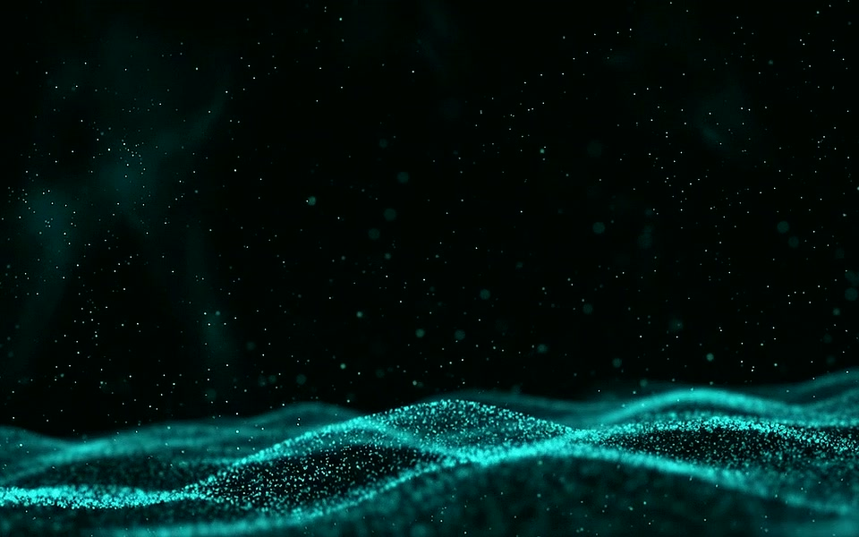

# Black Turq

Inspired by the anodised‑ink colour pattern of my Evo80 keyboard, this theme fuses deep black with vibrant turquoise accents to create a modern, high‑contrast workspace.
Designed for the Omarchy environment, it balances sleek minimalism with vivid detail to keep your focus sharp.
Built out of passion for custom hardware aesthetics and functional beauty — because your system deserves to look as good as it performs.


# Installation Theme

To install this theme, simply use the omarchy-theme-install command:

```bash
omarchy-theme-install https://github.com/HANCORE-linux/omarchy-blackturq-theme.git
```
## Animated background (optional)

A turquoise particle-wave video is available as an optional moving background:

[](backgrounds/blackturq-motion-loop.mp4)

[Download the loop](backgrounds/blackturq-motion-loop.mp4) · [Playback and source details](docs/animated-background.md)

The silent H.264 video runs at 60 fps and loops every 11.5 seconds. It is an
upscaled 2048 × 1280 render from a 720p Gemini-generated source, with optical-flow
interpolation and a motion-aligned transition.

After installing the theme, select it in a video-capable Omarchy version:

```bash
omarchy theme bg set "$HOME/.config/omarchy/themes/blackturq/backgrounds/blackturq-motion-loop.mp4"
```

# Screenshots


#### Waybar
[LINK](https://github.com/HANCORE-linux/waybar-themes)

#### Theme-Hook-Manager
[Link](https://github.com/OldJobobo/theme-hook-plugin-manager)
